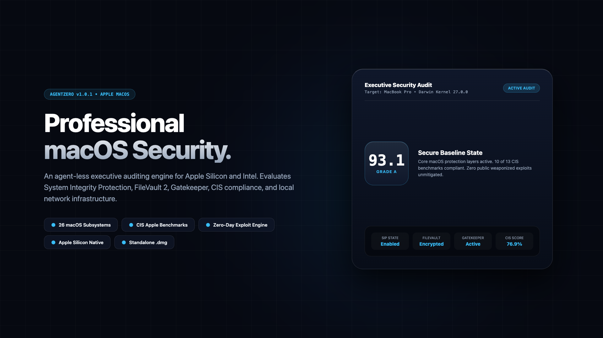

# 🛡️ AgentZero (v1.0.1)



**Agent-less macOS System Vulnerability & Network Security Scanner**

> A blue team security auditing desktop application that identifies and maps potential vulnerabilities of macOS subsystems (SIP, FileVault, Gatekeeper, LaunchDaemons, TCC, Firewall) and local network infrastructure to secure against system-level and network-level threats.

[](LICENSE)
[](https://www.apple.com/macos/)
[](https://www.electronjs.org/)
[](https://www.python.org/)

---

## Overview

AgentZero is an on-demand, standalone desktop application packaged as a native macOS DMG (`.dmg`) and application bundle (`.app`). It operates completely agent-less — when executed, it rapidly audits core macOS security frameworks, maps local network topology, cross-references system state against known Apple CVEs and CIS macOS Benchmarks, and produces consolidated HTML and PDF executive audit reports.

### Key Features

- **🔍 macOS System Security Auditing** — Audits 26 security vectors including System Integrity Protection (SIP), FileVault 2 encryption, Gatekeeper / XProtect, Application Firewall, LaunchDaemons / LaunchAgents persistence, SUID permissions, root account status, and exposed shell history credentials.
- **🌐 Network Reconnaissance** — Discovers local subnet devices, ARP neighbor table, DNS resolvers, active TCP sockets, listening ports, Bonjour/mDNS service advertisements, and mounted network shares.
- **⚠️ Vulnerability Detection** — Correlates host state with curated offline macOS CVEs and CIS Apple macOS 14/15 Benchmark rules.
- **🕷️ Exploit Intelligence** — Cross-references weaponized zero-day exploits (BLASTPASS, Pegasus, Operation Triangulation, XNU kernel vulnerabilities, SIP bypasses).
- **📊 Interactive Network Topology** — Renders interactive SVG network diagrams mapping the host, gateway, DNS servers, and local subnet neighbors.
- **📄 Consolidated Audit Reports** — Generates executive HTML and PDF reports with CVSS v3.1 severity scores and step-by-step remediation commands.
- **📦 Native macOS Desktop App** — Packaged via Electron Builder as a native Apple Silicon (`arm64`) `.dmg` installer with drag-to-Applications layout and multi-resolution Apple icon branding.

---

## Architecture

```
┌─────────────────────────────────────────────────────────┐
│               Electron Desktop Shell (macOS)            │
│  ┌───────────────────────────────────────────────────┐  │
│  │               React Cyber Dashboard               │  │
│  │  ┌──────────────┐ ┌──────────────┐ ┌───────────┐  │  │
│  │  │ System Audit │ │ Network Recon│ │ Vuln Intel│  │  │
│  │  └──────┬───────┘ └──────┬───────┘ └───┬───────┘  │  │
│  └─────────┼────────────────┼─────────────┼──────────┘  │
│            └────────────────┼─────────────┘             │
│                      IPC Bridge                         │
│            ┌────────────────┴─────────────┐             │
│            │     Python 3 Scanning Engine │             │
│            │  ┌───────────┐ ┌───────────┐ │             │
│            │  │ macOS Core│ │ macOS Net │ │             │
│            │  │  Scanner  │ │  Scanner  │ │             │
│            │  └───────────┘ └───────────┘ │             │
│            │  ┌─────────────────────────┐ │             │
│            │  │  CIS & CVE Vuln Engine  │ │             │
│            │  └─────────────────────────┘ │             │
│            └──────────────────────────────┘             │
└─────────────────────────────────────────────────────────┘
```

---

## Quick Start

### 1. Prerequisites
- macOS 12+ (Apple Silicon `arm64` or Intel `x64`)
- Node.js 18+ & npm
- Python 3.9+ (preinstalled on macOS)

### 2. Development Mode
```bash
# Clone the repository
git clone https://github.com/AYUSH-KAVYA/agentZero.git
cd agentZero

# Install Node dependencies
npm install

# Launch Electron desktop app with live Vite reload
npm run dev:electron
```

### 3. Build Native macOS Desktop App (.dmg)
```bash
# Compile React frontend and generate native Apple Silicon DMG
npm run build:mac
```
The resulting installer will be located at:
`release/AgentZero-1.0.0-arm64.dmg`

---

## 26 macOS System Audit Modules

1. **`os_info`** — macOS Version (`sw_vers`), Kernel, Darwin release, Hardware Model (`sysctl hw.model`), Processor, Uptime.
2. **`dotnet_versions`** — FileVault 2 Full Disk Encryption status (`fdesetup status`).
3. **`amsi_providers`** — System Integrity Protection (SIP) state (`csrutil status`).
4. **`antivirus`** — EDR & System Extensions (`systemextensionsctl list`).
5. **`audit_policy`** — OpenBSM audit daemon flags (`/etc/security/audit_control`).
6. **`autorun`** — LaunchDaemons persistence plists in `/Library/LaunchDaemons`.
7. **`firewall`** — Application Firewall (`socketfilterfw --getglobalstate`, stealth mode).
8. **`defender`** — Gatekeeper code signing enforcement (`spctl --status`) & XProtect definitions.
9. **`certificates`** — Keychain Root Certificates in System Keychain (`security find-certificate`).
10. **`environment`** — Environment variables and `$PATH` directory security.
11. **`file_listing`** — Sensitive user key files (`~/.ssh`, permissions).
12. **`file_info`** — SUID/SGID binaries across system directories.
13. **`hotfixes`** — Rapid Security Responses (RSR) and macOS build version.
14. **`installed_products`** — Installed applications in `/Applications` & Homebrew packages.
15. **`group_policy`** — Configuration Profiles & MDM enrollment (`profiles status`).
16. **`local_groups`** — Members of `admin` and `wheel` directory groups (`dscl`).
17. **`local_users`** — Local directory users and Guest account status (`dscl`).
18. **`ms_updates`** — Automatic software update background schedule (`softwareupdate --schedule`).
19. **`ntlm_settings`** — Local account password policies (`pwpolicy`).
20. **`rdp_connections`** — Remote Apple Events and sharing services (`systemsetup`).
21. **`rdp_sessions`** — Screen Sharing & VNC port 5900 listener status.
22. **`rdp_settings`** — Remote Login (OpenSSH) configuration (`systemsetup -getremotelogin`).
23. **`secure_boot`** — Apple Silicon Secure Boot policy and kernel boot arguments (`nvram`).
24. **`sysmon`** — LaunchAgents persistence plists in `/Library/LaunchAgents` and `~/Library/LaunchAgents`.
25. **`uac_policies`** — Root account direct authentication and sudoers policy.
26. **`powershell_history`** — Shell command history (`~/.zsh_history`, `~/.bash_history`) credential exposure.

---

## License

This project is licensed under the MIT License — see the [LICENSE](LICENSE) file for details.
